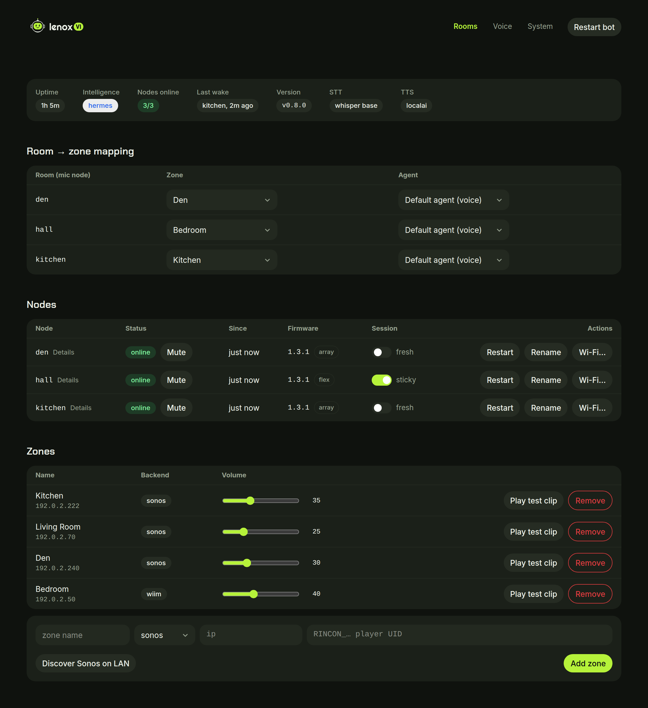
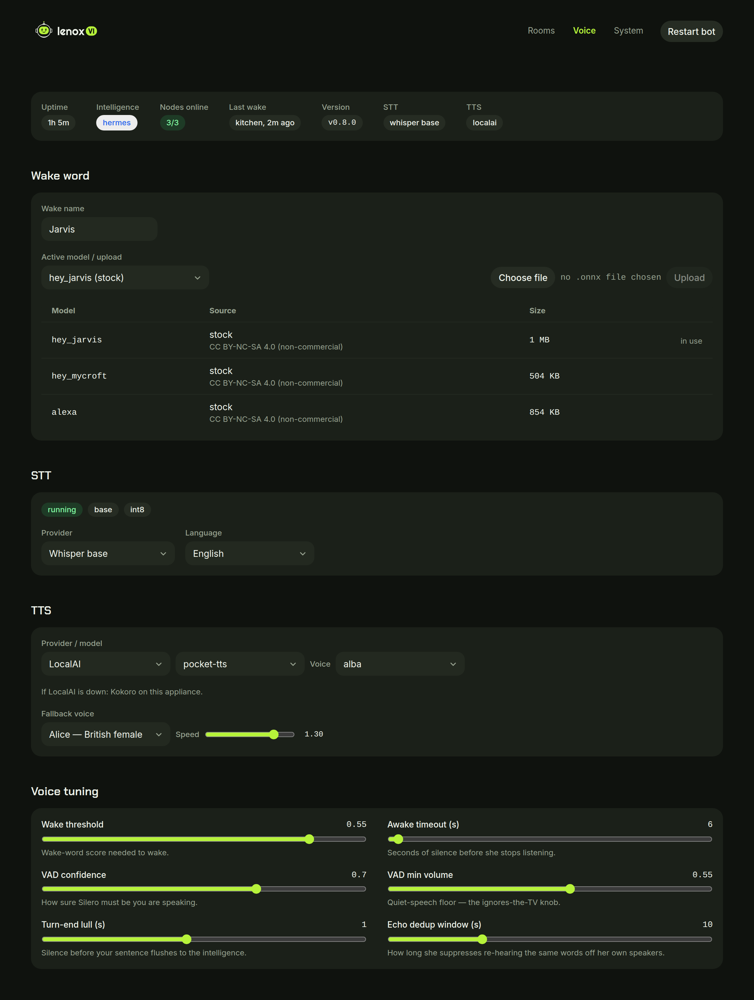
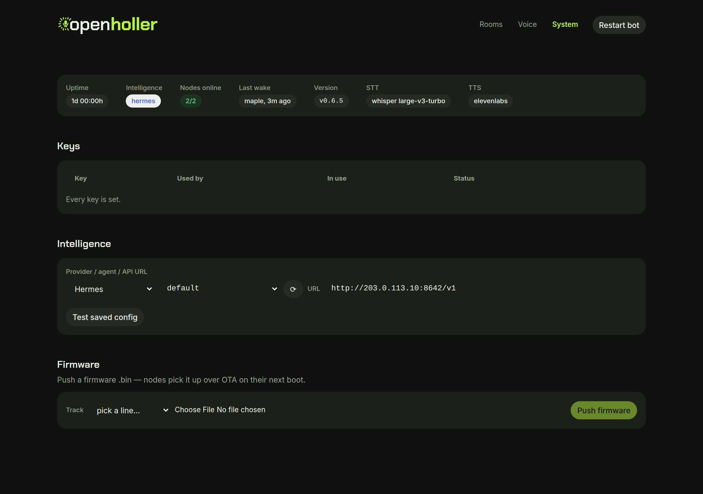

<picture>
  <source media="(prefers-color-scheme: dark)" srcset="dashboard-ui/public/lenoxvi-horizontal-on-dark.svg">
  
</picture>

# LenoxVI

High quality multi-zone audio for your AI agent, with mic and room routing + audio ducking. Local, cloud or hybrid based on your use case. Audio routes through Sonos or WiiM audio speakers. Mics from ReSpeaker (Array, Flex) or Waveshare, including in-ceiling microphones matching architectural speakers. Web dashboard for easy and fast tuning of voice pipeline!

    mic node → WiFi/WebRTC → wake gate → speech to text →
    intelligence (Hermes / OpenClaw / Nanobot) → text to speech →
    speaker in the room (Sonos / WiiM / the node's own speaker)

The wake word always runs on your hardware. Speech and voice can stay local or go to the cloud, per lane. Wake-gated, not a chat box: the dashboard operates the appliance, it does not talk to it.



## Install

Ubuntu 22.04 / 24.04 / 26.04, Debian 12 / 13 or Raspberry Pi OS (64-bit), on x86_64 or arm64. No Docker.

```bash
sudo apt install git          # Debian and Raspberry Pi OS images may not have it
git clone https://github.com/LenoxSI/lenoxvi.git
cd lenoxvi
sudo bash scripts/install.sh
```

The installer checks the machine, installs only the system packages that are missing (it asks first), and asks
three questions: this machine's LAN address, whether speech-to-text runs on the GPU or the CPU, and whether to
protect the dashboard with a token. Then it installs the newest release, downloads the speech models, starts the
`lenoxvi` service and prints the dashboard address. A few minutes on a fresh box.

It needs no keys: the voice is local (Kokoro) and the brain answers with an echo until you pick one on the
dashboard. Keys, voices, rooms and speakers are all set there.

- Code goes to `/opt/lenoxvi` (read-only to the bot). Settings, keys, certs and models go to `/var/lib/lenoxvi`.
- It never installs GPU drivers, never reboots, and never overwrites an existing config or keys file. Running it
  again is safe: it only fills in what's missing.
- `--yes --host <ip>` answers every question with its default, `--dry-run` prints each step without doing it,
  `--help` lists the rest.

### The `lenoxvi` command

| Command | What it does |
|---|---|
| `lenoxvi status` | Service state, version and dashboard address (add `sudo` for the address) |
| `sudo lenoxvi logs [-f]` | The last 100 log lines; `-f` keeps following |
| `sudo lenoxvi restart` | Restarts the bot and waits for the dashboard |
| `sudo lenoxvi reconfigure` | Changes the LAN address, the speech-to-text profile or the dashboard token |
| `sudo lenoxvi upgrade [--to vX.Y.Z]` | Moves to the newest release (or the one given); goes back on its own if it doesn't come up |
| `sudo lenoxvi uninstall [--purge]` | Removes LenoxVI and keeps your data; `--purge` also deletes settings, keys and models |

### Run from a clone (manual)

For development. Python 3.12+. From the repo root:

1. `python3 -m venv .venv && . .venv/bin/activate && pip install -r requirements.txt` (on an NVIDIA GPU host add `-r requirements-gpu.txt`; Debian and Ubuntu need `sudo apt install python3-venv` first)
2. `cp config.example.yaml config.yaml` (the voice, intelligence and speakers are set later on the dashboard)
3. `cp .env.example .env` and set `ELEVENLABS_API_KEY` and `LVI_TTS_VOICE_ID` for the default voice, plus the key for your intelligence (`LVI_HERMES_KEY`, `LVI_OPENCLAW_KEY` or `LVI_NANOBOT_KEY`)
4. `bash scripts/make-cert.sh <bot-host-LAN-IP>` — mic access needs HTTPS
5. `python bot.py --host <bot-host-LAN-IP> --port 7860 --esp32`, then open `https://<bot-host-LAN-IP>:7860/dashboard`

**Hey Jarvis** works out of the box. `/client` on the same host is a browser mic for a first test.

## Features

| Feature | What |
|---|---|
| Wake gate | "Hey Jarvis" out of the box. Train your own. |
| Turn-taking | Optional wake-word barge-in, echo containment, and filler lines while the agent thinks. |
| Rooms | Each mic node maps to a speaker zone and can use its own agent. Sessions are sticky or fresh per room. |
| Local or cloud | Whisper, Pocket and Kokoro run on your hardware, or on a LocalAI server on your network. Cloud providers can fall back to local ones. |
| Firmware | Push node images over the air from the dashboard. |
| Dashboard | LAN-only. Keys, zones, voices and models in one place. |

## Dashboard

Demo data.





## Speech to text

✅ runs on your hardware. ❌ goes to the cloud.

| Provider | Local | Fallback |
|---|---|---|
| Whisper | ✅ | — |
| Deepgram Nova-3 | ❌ | The configured Whisper model |
| ElevenLabs Scribe v2 | ❌ | The configured Whisper model |

### Whisper models

Turbo and Medium need a GPU.

| Model | Size | Needs | Best for |
|---|---|---|---|
| `large-v3-turbo` | 1.6 GB | GPU | Best all-round. The default. |
| `medium` | 1.5 GB | GPU | Faster, solid in noise. |
| `small` | 0.5 GB | CPU is fine | Snappy in quiet rooms. |
| `base` | 0.15 GB | CPU is fine | No GPU, or the fastest option. |

## Intelligence

| System | Talks to | Session history | Spoken style |
|---|---|---|---|
| Hermes | Hermes API, bearer key | Hermes keeps it | LenoxVI sends voice instructions: short spoken sentences, no markdown |
| OpenClaw | OpenClaw Gateway, model `openclaw/<agent>` | Sticky per room via a session key | Same as Hermes |
| Nanobot | OpenAI-compatible API: one message plus `session_id` | Nanobot keeps it | Set in the nanobot agent: LenoxVI cannot send it a system message |

## Text to speech

| Provider | Local | Fallback |
|---|---|---|
| ElevenLabs Flash v2.5 or v4 Turbo | ❌ | Kokoro or Pocket |
| Deepgram Flux or Aura-2 | ❌ | Kokoro or Pocket |
| Pocket | ✅ | — |
| Kokoro | ✅ | Pocket, if installed |
| LocalAI (your network) | ✅ | Kokoro, always |

### Local voices

Kokoro ships with every install (`requirements.txt`); fetch its model files once:

    bash scripts/fetch_kokoro_models.sh

Pocket is optional:

    pip install -r requirements-pocket.txt && bash scripts/fetch_pocket_weights.sh

Pick one in the dashboard's TTS panel, or set either as the fallback behind a cloud voice (new configs start with Kokoro). Kokoro's model is Apache-2.0 and kokoro-onnx is MIT; its phonemes come from espeak-ng (GPL-3.0), loaded as a shared library and not bundled.

## LocalAI

Run speech models on another machine on your network (a GPU box, say) with [LocalAI](https://github.com/mudler/LocalAI). Audio stays in the house. Pick **LocalAI** on the STT card, the TTS card, or both.

1. On the LocalAI host: install `ffmpeg` (LocalAI needs it for every transcription), and set an API key (`LOCALAI_API_KEY`).
2. Add a faster-whisper model, e.g. `faster-whisper-small.yaml` in LocalAI's models folder:

       name: faster-whisper-small
       backend: faster-whisper
       known_usecases:
         - transcript
       parameters:
         model: small        # or large-v3-turbo on a GPU
       # cuda: true          # on a GPU

   Restart LocalAI after adding a model so it shows in its model list. A Kokoro model from LocalAI's gallery covers speech.
3. On the dashboard: System · LocalAI → the address (`192.0.2.50:8080`), System · Keys → the LocalAI key, **Test** to see what it serves, then pick its models on the STT and TTS cards and restart.

If LocalAI stops answering, this appliance listens with Whisper base and speaks with Kokoro, sentence by sentence, and goes back to LocalAI once it answers again. LenoxVI never installs or changes models on LocalAI.

## Speakers

Each zone picks Sonos or WiiM. The difference that matters is ducking.

| | Sonos | WiiM |
|---|---|---|
| How a reply plays | Audio clip overlay, mixed over what is playing | Replaces what is playing |
| Music while she talks | Ducks and keeps playing | Stops and is not resumed |
| Stays ducked while the room listens | ✅ | ❌ |
| Reply volume | Set per clip | Sets the main volume, then restores yours |
| Connects with | Local websocket: IP and player UID | HTTPS API: IP only |
| Built and tested on | Port, Amp, Era 100 SL | Pro |

WiiM's prompt-overlay command does nothing on the firmware we tested, so the backend interrupts instead of ducking.

### Sonos speakers that can duck

Ducking needs the `AUDIO_CLIP` capability, which [Sonos documents](https://docs.sonos.com/reference/audioclip) on every player running S2 and not on S1-only players. The groups below follow Sonos's [compatibility list](https://support.sonos.com/en-us/article/sonos-app-version-compatibility). Only the three tested models are confirmed here; the bot logs the capability check for each zone at startup.

| Can duck | Models |
|---|---|
| ✅ S2 only | Arc, Arc SL, Arc Ultra, Beam (Gen 2), Beam Ultra, Era 100, Era 100 Pro, Era 100 SL, Era 300, Five, Move 2, One SL, Ray, Roam, Roam 2, Roam SL, Sonos Play, Amp Multi, SYMFONISK Bookshelf (Gen 2), Floor lamp, Picture frame, Table lamp (Gen 2) |
| ✅ When set up on the S2 app | Amp, Beam (Gen 1), Move, One (Gen 1), One (Gen 2), Play:1, Play:3, Play:5 (Gen 2), Playbar, Playbase, Port, Connect (Gen 2), Connect:Amp (Gen 2), SYMFONISK Bookshelf (Gen 1), SYMFONISK Table lamp (Gen 1) |
| ❌ S1 only | Connect (Gen 1), Connect:Amp (Gen 1), Play:5 (Gen 1), ZonePlayer 80, 90, 100, 120 and S5, CR200 |

## Wake word

The default is **Hey Jarvis**, a stock openWakeWord model (also `hey_mycroft` and `alexa`). openWakeWord's pre-trained models are CC BY-NC-SA 4.0, non-commercial only. For anything commercial, train your own and upload the `.onnx` in the dashboard. Set the wake name to match.

## Security

LAN-only by design. Reading the dashboard needs no login. Changes are checked against the request's Origin and Host, and against `LVI_DASHBOARD_TOKEN` when it is set.

## License

No project license is set. Until one is, do not treat this repository as open source. The pre-trained wake-word models are non-commercial; see [Wake word](#wake-word).

## Help

Bugs and questions: [open an issue](https://github.com/LenoxSI/lenoxvi/issues).

## Repository

- `bot.py`, `core/` — the pipeline and its pieces; `core/intelligence/` has one module per intelligence system
- `dashboard-ui/` — the web dashboard; the built `dist/` is committed, so running it needs no node toolchain
- `config.example.yaml`, `.env.example` — settings and keys
- `deploy/` — example systemd unit
- `scripts/` — ops tools
- `tests/` — automated checks; they run from a fresh clone against `tests/fixtures/config.yaml`. Steps that play audio on a real speaker or scan the LAN only run with `LVI_TEST_LIVE=1`

Reply clips, uploaded wake models and firmware, and session history are written under the repo folder. Set `LVI_STATE_DIR` to keep them somewhere else.
